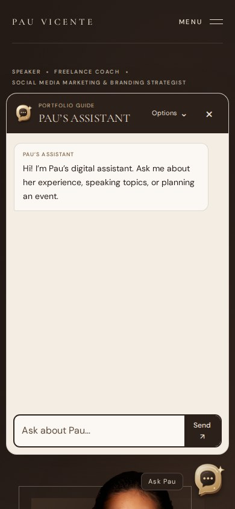
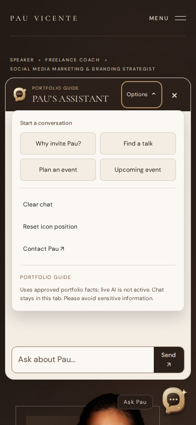
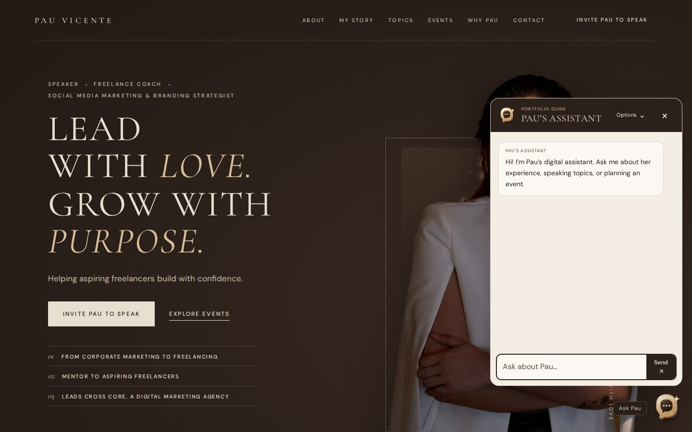
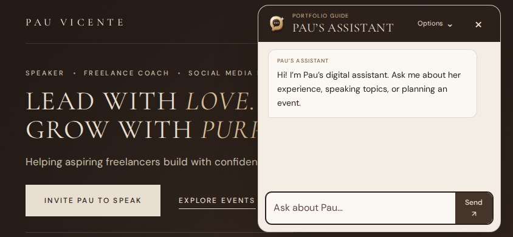

# Assistant review

Custom dimensional speech icon, a compact conversation panel, and secondary controls in a closed Options dropdown. Reply sources are collapsed too.

Checked in Chromium at 1440×900, 390×844, 360×740 and 844×390, using mocked APIs.

Run `python scripts/check-assistant-browser.py` for current screenshots, including multi-message conversations. Current screenshots are retained in the PR workflow artifacts.
