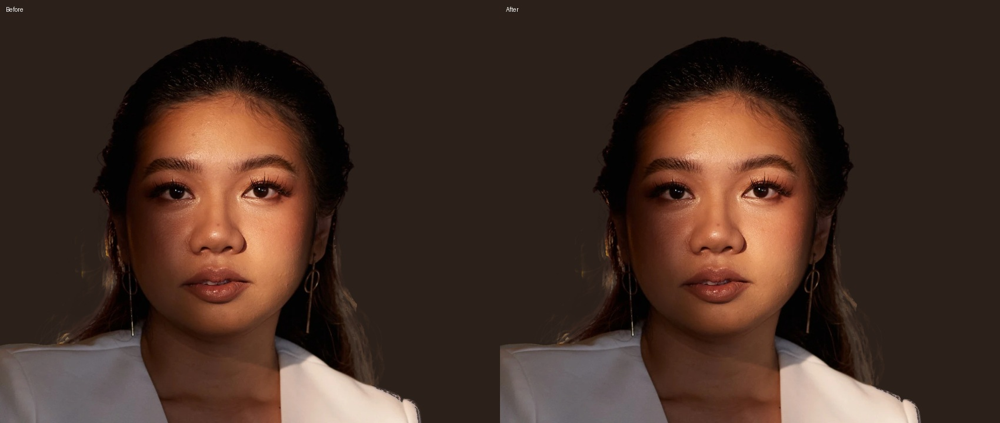
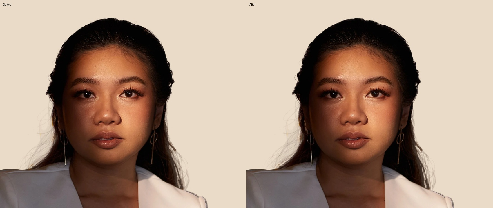

# Hero cutout edge review

Localized transparency cleanup of the existing hero cutout. No face generation, retouching, colour correction or photo resampling.

- Softens jagged silhouette pixels and removes detached alpha crumbs.
- Keeps the opaque interior and a protected face rectangle unchanged.
- Preserves each original WebP VP8 photographic bitstream exactly, replacing only the lossless ALPH chunk. PNG RGB is also unchanged.
- All five existing responsive image dimensions and paths remain unchanged.
- This is a conservative refinement of the existing mask, not a reconstruction of lost hair detail.

## Comparison

Before is on the left; after is on the right.

Machine checks and file sizes: [verification.json](verification.json).

To reproduce from the fixed source commit: install Pillow, numpy and scipy, fetch full Git history, then run `python scripts/cutouts/refine-hero-edge.py`. It always reads the original assets from commit `c72ea2aa895d558982b704bb851e78fe6f733f45`, so rerunning does not erode the result again.

WebP container reference: https://developers.google.com/speed/webp/docs/riff_container
