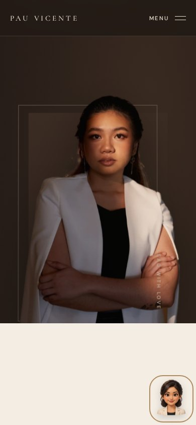
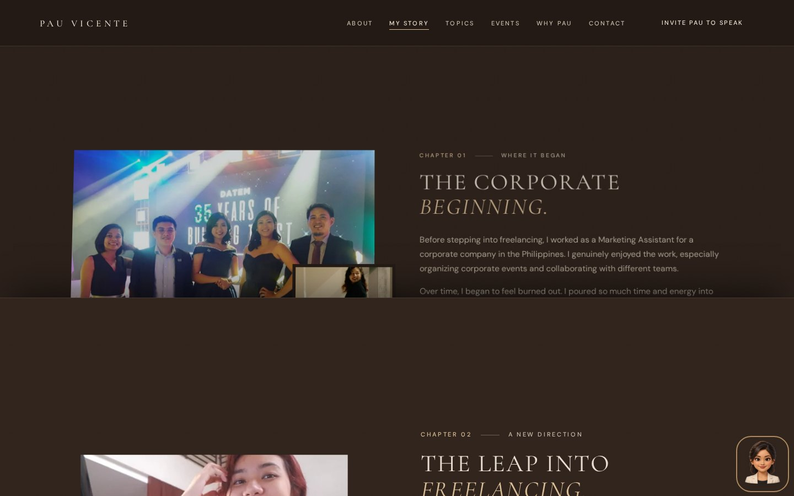

# Continuous scroll and animated emoji review

All major sections gain scroll-linked perspective, depth, scale and opacity with smooth settling. Native document scrolling has no snap points. Story pages keep their natural content height and turn in 3D on desktop and phone. The original portrait layering and cinematic Moments controller are retained.

The assistant uses a generic stylized human emoji bust with an ivory blazer, distinct from Pau's real face. The approved generated source sheet is in `source-assets/assistant/pau-emoji-sheet.png`. It contains forward, left, right and blink eye states. `scripts/export-assistant-emoji.py` exports four aligned 256px transparent WebP frames. CSS coordinates eye states with gentle 3D head motion; reduced motion displays a still front frame.

The welcome bubble introduces the digital guide. Opening or dismissing it hides it for the session; Options and reply sources remain collapsed. The floating launcher is hidden while the panel is open.

Browser checks exercise every major section at 1440×900, 1024×620, 390×844, 360×740 and 844×390. They verify changing perspective while scrolling, native scrolling, readable chapter endings, eye/frame animation, the welcome bubble, reduced motion and overflow. APIs are mocked.

`avatar-assets.json` records asset sizes and hashes. Current screenshots are also retained in the PR workflow artifact.
